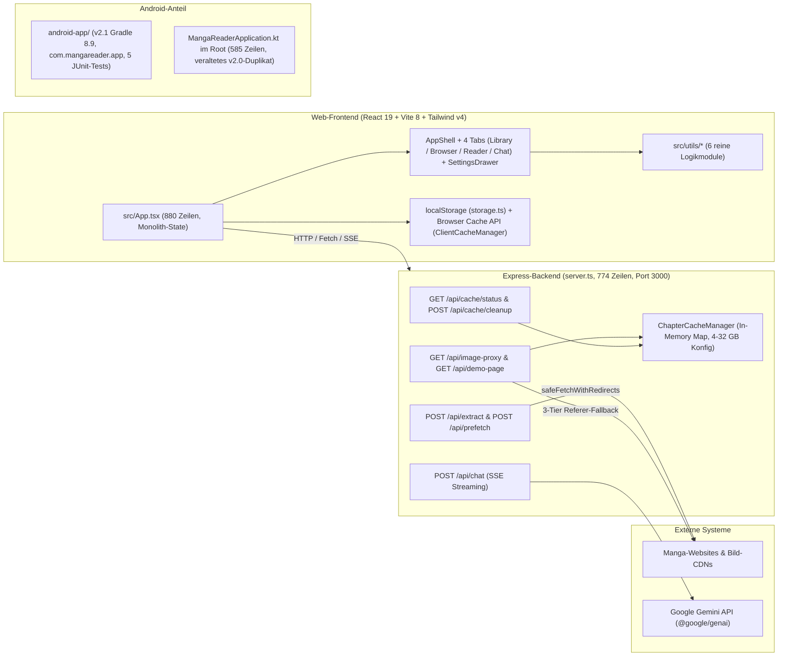

# Technisches Audit — MangaReaderApp

> **Geprüftes Repository:** `x:\Google Antigravity\MangaReaderApp_Web_Backup`  
> **Stand / HEAD-Commit:** `1407d2e` (`feat(android): upgrade android-app to v2.1 with 1:1 GitHub AMOLED UI and full native engine`)  
> **Prüfumfang:** `GEMINI.md`, `package.json`, `tsconfig.json`, `vite.config.ts`, `server.ts`, alle Dateien unter `src/`, `android-app/` sowie die lose Root-Datei `MangaReaderApplication.kt` (reine Read-only-Analyse, **kein Produktivcode verändert**).  
> **Verifizierte Laufzeit-Baseline:** Node `v26.13.1`, npm `11.12.1`, TypeScript `7.0.2` · `npx tsc --noEmit` → Exit `0` (allerdings **ohne** `strict: true`) · `npx tsx --test src/utils/*.test.ts` → `26/26` Tests bestanden.

---

## 1. Executive Summary & Risikomatrix

Die **MangaReaderApp** ist eine funktionsreiche Full-Stack-Webanwendung (React 19, TypeScript, Tailwind CSS v4, Vite 8, Express 4) im AMOLED-Dunkeldesign (`#000000`), die ein vollständiges natives Android-/Kotlin-Gegenstück unter `android-app/` (`v2.1`) sowie ein veraltetes Root-Relikt (`MangaReaderApplication.kt`) mitführt. Die reinen Logikmodule unter `src/utils/` sind sauber modularisiert und durch 26 Unit-Tests abgesichert. Gleichzeitig weisen das Express-Backend (`server.ts`), der SSRF-Validator (`src/utils/urlSafety.ts`), das Server-/Client-Caching (`ChapterCacheManager` / `ClientCacheManager`) sowie die Projekt-Hygiene erhebliche Sicherheits-, Stabilitäts- und Betriebsrisiken auf.

| ID | Bereich | Schweregrad | Kernbefund | Fundstelle |
| :--- | :--- | :---: | :--- | :--- |
| **SEC-01** | SSRF / DNS | **Kritisch** | DNS-Rebinding-TOCTOU zwischen `assertHostResolvesPublic()` und `fetch()` ohne IP-Pinning | [`server.ts:78-121`](../server.ts#L78-L121) |
| **CACHE-01** | Cache / Stabilität | **Kritisch** | `ChapterCacheManager` hält alle Bild-Buffer im **Node.js-RAM**, erlaubt aber `4–32 GB` Limit → OOM-Crash-Risiko & fehlende Persistenz | [`server.ts:43-48`](../server.ts#L43-L48), [`src/utils/cacheManager.ts:83-293`](../src/utils/cacheManager.ts#L83-L293) |
| **SEC-02** | SSRF / IPv6 | **Hoch** | IPv4-mapped IPv6-Hex-Kanonisierung (`[::ffff:169.254.169.254]` → `[::ffff:a9fe:a9fe]`) umgeht `isPrivateOrLoopbackIp()` komplett | [`src/utils/urlSafety.ts:31-48`](../src/utils/urlSafety.ts#L31-L48) |
| **SEC-03** | SSRF / CIDR | **Hoch** | Fehlende IPv4-/IPv6-Bereiche (`225–239.*` Multicast, `198.18.0.0/15`, `241–254.*`, NAT64 `64:ff9b::/96`, 6to4 `2002::/16`, `ff00::/8`, Zone-IDs) | [`src/utils/urlSafety.ts:1-65`](../src/utils/urlSafety.ts#L1-L65), [`android-app/.../UrlSafety.kt`](../android-app/app/src/main/java/com/mangareader/app/util/UrlSafety.kt) |
| **STAB-01** | Netzwerk / DoS | **Hoch** | `READ_TIMEOUT_MS` wirkt nicht während blockierendem `reader.read()` (Slowloris-/Tarpit-Hänger); fehlendes `res.body?.cancel()` bei Redirects | [`server.ts:108-168`](../server.ts#L108-L168) |
| **SEC-04** | Image-Proxy | **Hoch** | 15 MB Vorab-Buffering vor `Content-Type`-Prüfung; keine Magic-Byte-/0-Byte-Validierung; fehlendes `nosniff`; 30-Tage-`immutable`-Cache-Poisoning möglich | [`server.ts:434-468`](../server.ts#L434-L468) |
| **CACHE-02** | Race Conditions | **Hoch** | Globaler Singleton-Cache (Slider-POST-Sturm ohne Debounce überschreibt Limit für alle Clients), Server-TOCTOU (`clearAll` vs. laufender Fetch), Client-`localStorage`-Race ohne Mutex | [`server.ts:208-230,457`](../server.ts#L208-L230), [`src/utils/cacheManager.ts:477-652`](../src/utils/cacheManager.ts#L477-L652), [`src/App.tsx:143-202`](../src/App.tsx#L143-L202) |
| **CHAT-01** | SSE / Gemini | **Hoch** | Keine Stream-/Idle-Timeouts, fehlender Client-Disconnect-Abbruch (`req.on('close')`), fehlendes Rate-Limiting (Quota-Drain) | [`server.ts:609-688`](../server.ts#L609-L688) |
| **SEC-05** | SSRF / Hostnames | **Mittel** | Trailing-Dot-Bypässe (`http://localhost./`, `http://metadata.google.internal./`), beliebige Zielports (`:22`, `:6379`), Brackets `[...]` an `dns.lookup()` | [`src/utils/urlSafety.ts:94-103`](../src/utils/urlSafety.ts#L94-L103), [`server.ts:106`](../server.ts#L106) |
| **STAB-02** | Image-Proxy & Demo | **Mittel** | Referer-Duplikat bei Same-Origin, 3×-Retry auf Nicht-403-/SSRF-Fehlern, Prototype-Property-Crash in `/api/demo-page` (`?asset=constructor`) | [`server.ts:240,374-481`](../server.ts#L240) |
| **CHAT-02** | SSE / Prompting | **Mittel** | Fehlendes `X-Accel-Buffering: no`, kein Heartbeat, Roh-Exception-Leak, Prompt-Injection über `context`-Newlines, fehlender Client-`TextDecoder`-Flush | [`server.ts:633-686`](../server.ts#L633-L686), [`src/utils/chatHelpers.ts:108-154`](../src/utils/chatHelpers.ts#L108-L154), [`src/components/ChatView.tsx:128-160`](../src/components/ChatView.tsx#L128-L160) |
| **HYG-01** | Projekt-Hygiene | **Mittel** | Lockfile-Konflikt (`bun.lock` vs. untracked `package-lock.json`), fehlendes `strict: true`, defektes `"start": "node server.ts"`, tote Root-`MangaReaderApplication.kt` mit altem Path-Bug, keine Server-/UI-Tests, keine aktive `.github/workflows/`-CI | [`package.json`](../package.json), [`tsconfig.json`](../tsconfig.json), [`MangaReaderApplication.kt:333`](../MangaReaderApplication.kt#L333) |

---

## 2. Architektur-Überblick

Das Repository bildet ein **duales Hybrid-Projekt** aus einer produktiven Full-Stack-Web-App (Root) und einer eigenständigen nativen Android-App (`android-app/`), ergänzt durch eine veraltete Einzeldatei im Root (`MangaReaderApplication.kt`).

### 2.1 Web-Frontend (`src/`)

- **Technologie-Stack:** React `19.0.1`, TypeScript `7.0.2`, Tailwind CSS `v4.3.3` (`@tailwindcss/vite`), Vite `8.3.0`, `lucide-react` `0.546.0`.
- **Einstieg & State-Management:** [`index.html`](../index.html) → [`src/main.tsx`](../src/main.tsx) → [`src/App.tsx`](../src/App.tsx) (880 Zeilen). `App.tsx` hält nahezu den gesamten Anwendungszustand zentral (Tabs, Lesezeichen, Verlauf, Downloads, Browser-Tabs, Chatverlauf, aktuelles Kapitel, Seitenindex, Autoscroll, Pre-Fetching, Settings, Toasts) und persistiert ihn über `serializedStorage` ([`src/utils/storage.ts`](../src/utils/storage.ts), 400 ms Debounce + Promise-Write-Queue) in `localStorage`.
- **UI-Komponenten (`src/components/`, 9 Dateien):**
  - [`AppShell.tsx`](../src/components/AppShell.tsx) (136 Z.): Dreizonige Desktop-Top-Bar und mobile 4-Tab-Daumenleiste.
  - [`LibraryView.tsx`](../src/components/LibraryView.tsx) (588 Z.): Lesezeichen, Verlauf, Offline-Downloads, Direktstart-Katalog/Diagnose-Labor sowie Bild-Cache-Fortschrittsbalken.
  - [`BrowserView.tsx`](../src/components/BrowserView.tsx) (400 Z.): Multi-Tab-Verwaltung (`152px–220px` Tabs, isolierter `24×24px`-Schließen-Button, striktes `key={activeTab.id}-${reloadNonce}`).
  - [`ReaderView.tsx`](../src/components/ReaderView.tsx) (832 Z.): AMOLED-`#000000`-Reader für `webtoon` und `paged` (`rtl`/`ltr`), Zoom `1.0x–4.0x`, nicht-blockierende Tap-Zonen (`22 % / 56 % / 22 %`), `ChapterEndFooter`, Autoscroll-Floating-Pill inkl. `navigator.wakeLock`, Software-Dimmer & Sepia-Overlay.
  - [`ReaderPageItem.tsx`](../src/components/ReaderPageItem.tsx) (452 Z.): Lädt Seiten per `fetch()` als `Blob`/`ObjectURL` mit `400ms → 800ms → 1600ms` Auto-Retry, Buffer-Prefix-Prüfung, `createImageBitmap()`-Vorab-Dekodierung und Einzelbild-Cache-Bypass.
  - [`ImageErrorView.tsx`](../src/components/ImageErrorView.tsx) (214 Z.): Diagnosekarten für `HTTP_404`, `HTTP_403`, `HTML_CHALLENGE`, `DECODE_ERROR`, `HTTP_429`, `HTTP_5XX`, `TIMEOUT`, `NETWORK_ERROR`.
  - [`ChatView.tsx`](../src/components/ChatView.tsx) (446 Z.): Multi-Turn-Assistent mit Persona- und Modellwahl über SSE.
  - [`SettingsDrawer.tsx`](../src/components/SettingsDrawer.tsx) (675 Z.): Toggle-Schalter für alle 4 QoL-Features sowie Cache-Limit-Konfiguration (`512 MB – 32 GB`).
  - [`ToastStack.tsx`](../src/components/ToastStack.tsx) (43 Z.): Snackbar-/Toast-Stapel.
- **Reine Logikmodule (`src/utils/`, 6 Module) & Daten:**
  - [`urlSafety.ts`](../src/utils/urlSafety.ts) (132 Z.), [`urlChapterAnalyzer.ts`](../src/utils/urlChapterAnalyzer.ts) (202 Z.), [`imageDiagnostics.ts`](../src/utils/imageDiagnostics.ts) (333 Z.), [`cacheManager.ts`](../src/utils/cacheManager.ts) (681 Z.), [`chatHelpers.ts`](../src/utils/chatHelpers.ts) (161 Z.), [`storage.ts`](../src/utils/storage.ts) (65 Z.).
  - [`src/types/manga.ts`](../src/types/manga.ts) (132 Z.) und [`src/data/catalog.ts`](../src/data/catalog.ts) (268 Z., lokale Demo-Kapitel und CDN-Diagnose-Labor).
- **Wichtige architektonische Grenzen im Web-Frontend:**
  1. **Kein eingebetteter Live-Browser:** Anders als die Android-WebView rendert `BrowserView.tsx` fremde Websites nicht im `<iframe>` oder WebView — bei unbekannten URLs zeigt er nur die URL-Analyse und delegiert die HTML-Extraktion per `POST /api/extract` an `server.ts`. Dadurch lassen sich interaktive Cloudflare-Challenges im Web-Browser-Tab nicht direkt lösen; der Button *„Im Browser öffnen“* in `ImageErrorView` führt nur zurück zur Extraktionsansicht.
  2. **Metadaten-only Offline-Downloads (`src/App.tsx:588-637`):** `handleDownloadChapter` lädt im Web keine Bilddateien in die Browser Cache API oder IndexedDB herunter, sondern prüft lediglich `page.simError === '404'` und speichert das `MangaChapter`-Objekt in `localStorage`.

### 2.2 Express-Backend (`server.ts`, 774 Zeilen)

- **Laufzeitmodell:** `express` `4.21.2` + `node:http`, `express.json({ limit: '256kb' })`, `app.disable('x-powered-by')`, gebunden an `0.0.0.0:${PORT}` (`3000`).
- **Dev vs. Prod (`server.ts:692-764`):** Im Entwicklungsmodus (`NODE_ENV !== 'production'`) bindet `server.ts` Vite als Middleware (`middlewareMode: true`) ein und liefert bei `DISABLE_HMR=true` unter `/@vite/client` einen eigenen ESM-Shim (`NOOP_VITE_CLIENT`) für CSS-Updates ohne WebSocket. In Produktion werden `dist/` statisch und jede andere GET-Route als SPA-Fallback (`dist/index.html`) bedient.
- **Shared-Code-Nutzung:** `server.ts` importiert direkt fünf TypeScript-Module aus `src/utils/` (`urlSafety.ts`, `urlChapterAnalyzer.ts`, `imageDiagnostics.ts`, `cacheManager.ts`, `chatHelpers.ts`).
- **API-Endpunkte:**

| Methode & Pfad | Zeilen in `server.ts` | Aufgabe |
| :--- | :--- | :--- |
| `GET /api/cache/status` | `198–206` | Gibt `CacheManagerStats` (optional mit geclamptem `?maxBytes=`) zurück |
| `POST /api/cache/cleanup` | `208–230` | Leert Cache (`clearAll: true`) oder setzt `maxSizeBytes` (512 MB–32 GB) und bereinigt |
| `GET /api/demo-page` | `233–335` | Deterministische Simulation von `404`, `403_html`, `429`, `503`, `null_bitmap`, `xml_challenge` |
| `GET /api/image-proxy` | `338–490` | Bild-Proxy mit Cache-Hit, 3-Tier-Referer-Fallback, Challenge-Erkennung & `X-Manga-Diagnostic` |
| `POST /api/extract` | `493–552` | Lädt Kapitel-HTML (max. 4 MB), extrahiert Bild-URLs (max. 150) & Kapitelnummer |
| `POST /api/prefetch` | `555–606` | Vorladen des Folgekapitels (nahezu duplizierter Code zu `/api/extract`) |
| `POST /api/chat` | `609–688` | Multi-Turn Gemini SSE-Streaming-Chat mit Allowlist & Persona-Systeminstruktionen |

- **Dokumentations-Drift zu `GEMINI.md`:**
  - `GEMINI.md:31` beschreibt `{ "url": "...", "cookieHeader"?: "..." }` für `/api/extract` — `server.ts:493-552` liest `req.body.cookieHeader` jedoch nicht aus.
  - `GEMINI.md:41` beschreibt `?simError=` auf `/api/image-proxy` — tatsächlich ist `simError` auf `/api/demo-page` implementiert.

### 2.3 Android-Anteil (`android-app/` & Root-`MangaReaderApplication.kt`)

- **`android-app/` (natives Android-Projekt v2.1):** Eigenständiger Gradle-8.9-Build (AGP `8.5.2`, Kotlin `2.0.20`, Compose BOM `2024.09.02`, Coil `2.7.0`, WorkManager `2.9.1`, OkHttp `4.12.0`, Coroutines `1.8.1`, `applicationId = "com.mangareader.app"`, `compileSdk = 34`, `minSdk = 26`). Implementiert echte WebView-Tabs (`BrowserScreen.kt`), JavaScript-DOM-Extraktion (`ImageExtractorJs.kt`), Hintergrund-Downloads (`MangaDownloadWorker.kt`), dateisystembasiertes Cache-Management (`ChapterCacheManager.kt`), `GuardedBitmapDecoder` (`android-app/.../MangaReaderApplication.kt:218-289`), direkten Gemini-Streaming-Client (`GeminiChatClient.kt` mit lokalem API-Key) und 5 JUnit-Testklassen.
  - *Hinweis zur Android-Konfiguration:* [`AndroidManifest.xml`](../android-app/app/src/main/AndroidManifest.xml#L11-L20) setzt `android:usesCleartextTraffic="true"` und `android:allowBackup="true"` — sofern API-Keys in `SharedPreferences` abgelegt werden, muss `backup_rules.xml` / `data_extraction_rules.xml` deren Ausschluss gewährleisten.
- **Root-`MangaReaderApplication.kt` (585 Zeilen):** Eine einzelne, in keinen Gradle-Build eingebundene Datei (`package com.mangareader`) im Wurzelverzeichnis — ein überholtes v2.0-Relikt (siehe Abschnitt 4.2).

---

## 3. Security- & Stabilitäts-Audit von `server.ts`

### 3.1 SSRF-Schutz (Redirects, IPv4/IPv6-Edge-Cases, DNS)

Der SSRF-Schutz verteilt sich auf [`src/utils/urlSafety.ts`](../src/utils/urlSafety.ts) und `assertHostResolvesPublic()` / `safeFetchWithRedirects()` in [`server.ts:78-134`](../server.ts#L78-L134). Eine empirische Überprüfung mit Node `v26.13.1` gegen `validateExternalUrl()` zeigte mehrere gravierende Lücken:

1. **[Kritisch] DNS-Rebinding / Time-of-Check-to-Time-of-Use (TOCTOU) (`server.ts:78-121`)**  
   `assertHostResolvesPublic(check.url.hostname)` ruft `dns.lookup(hostname, { all: true })` auf (`Z. 82`), prüft die IPs und verwirft sie anschließend. Der darauffolgende Aufruf `fetch(check.url.toString(), ...)` (`Z. 113`) startet über Undici eine **zweite, unabhängige DNS-Auflösung** ohne IP-Pinning. Ein Angreifer-Nameserver mit TTL `0` kann bei Abfrage 1 eine öffentliche IP (z. B. `93.184.216.34`) und bei Abfrage 2 `127.0.0.1` oder `169.254.169.254` zurückliefern.

2. **[Hoch] IPv4-mapped-IPv6-Hex-Kanonisierungs-Bypass (`src/utils/urlSafety.ts:31-48`)**  
   WHATWG `new URL()` normalisiert IPv4-mapped IPv6-Adressen automatisch in kanonische Hex-Form. **Empirisch verifizierte Testfälle gegen `validateExternalUrl()`:**
   - `http://[::ffff:169.254.169.254]/` → `url.hostname` = `[::ffff:a9fe:a9fe]` → **`valid: true`**
   - `http://[::ffff:7f00:1]/` → `url.hostname` = `[::ffff:7f00:1]` → **`valid: true`**
   - `http://[0:0:0:0:0:ffff:127.0.0.1]/` → `url.hostname` = `[::ffff:7f00:1]` → **`valid: true`**  
   *Ursache:* `isPrivateOrLoopbackIp()` schneidet `::ffff:` ab (`Z. 31-33`) und ruft sich rekursiv mit `a9fe:a9fe` bzw. `7f00:1` auf. Da dieser Teilstring weiterhin einen Doppelpunkt `:` enthält, greift `if (normalized.includes(':'))` (`Z. 36`), prüft nur `::1`, `fc/fd` und `fe80` und liefert `false`. Zudem übergibt `server.ts:106` `check.url.hostname` **mit eckigen Klammern** (`[::1]`) an `dns.lookup()`, was bei gültigen öffentlichen IPv6-Literalen fehlschlägt.

3. **[Hoch] Unvollständige IPv4- und IPv6-CIDR-Abdeckung (`src/utils/urlSafety.ts:1-65`)**  
   - **IPv4 (`PRIVATE_IPV4_PATTERNS`):** Prüft nur `^224\.`, `^240\.` und `^255\.` statt der vollständigen Blöcke `224.0.0.0/4` und `240.0.0.0/4`. Empirisch durchgelassen (`valid: true`): `225.0.0.1`, `239.255.255.250` (SSDP-Multicast), `241.0.0.1` sowie `198.18.0.1` (`198.18.0.0/15` Benchmarking), `192.0.0.0/24` und TEST-NET-Bereiche (`192.0.2.0/24`, `198.51.100.0/24`, `203.0.113.0/24`).
   - **IPv6:** Nicht blockiert werden NAT64 (`64:ff9b::/96`, z. B. `[64:ff9b::127.0.0.1]` → `[64:ff9b::7f00:1]`), 6to4 (`2002::/16`, z. B. `[2002:7f00:0001::]`), IPv4-translated (`::ffff:0:0:0/96`), Multicast (`ff00::/8`, z. B. `[ff02::1]`), deprecated Site-Local (`fec0::/10`), Documentation (`2001:db8::/32`), nicht-kanonische Langformen sowie Zone-IDs (`fe80::1%eth0`).
   - *Hinweis:* Dieselben IPv4-/IPv6-Regellücken bestehen identisch in [`android-app/app/src/main/java/com/mangareader/app/util/UrlSafety.kt`](../android-app/app/src/main/java/com/mangareader/app/util/UrlSafety.kt).

4. **[Mittel] Trailing-Dot-FQDN-Bypass & fehlende Port-Restriktion (`src/utils/urlSafety.ts:94-103`)**  
   Empirisch verifiziert: `http://localhost./` ergibt `hostname = "localhost."` und passiert `validateExternalUrl()` mit **`valid: true`** (ebenso `metadata.google.internal.` oder `router.local.`). Bei Endpunkten ohne `assertHostResolvesPublic()` (z. B. dem `referer`-Parameter in `server.ts:351` oder Android `UrlSafety.kt`) schlägt die Sperre damit fehl. Darüber hinaus sind beliebige Zielports (z. B. `http://example.com:22/`, `:6379/`) erlaubt.

5. **[Hoch] Redirect-Handling, Socket-/Stream-Leaks & defektes `READ_TIMEOUT_MS` (`server.ts:93-168`)**  
   - **Defektes Read-Timeout (Tarpit-/Slowloris-DoS):** In `safeFetchWithRedirects()` wird `CONNECT_TIMEOUT_MS` (`15_000` ms) im `finally`-Block (`Z. 120`) gelöscht, sobald die HTTP-Header vorliegen. In `readResponseWithLimit()` (`Z. 148-165`) wird `if (Date.now() > deadline)` nur **vor** dem nächsten `await reader.read()` geprüft. Sendet ein Upstream `200 OK` und hält die Verbindung danach ohne weitere Bytes offen, hängt `await reader.read()` unbegrenzt (kein `AbortController` auf dem Body-Stream!).
   - **Fehlendes `res.body?.cancel()` bei 3xx-Redirects (`Z. 123-128`):** Redirect-Response-Bodies werden nicht verworfen, was Sockets/Streams offen hält.
   - **Cross-Origin-Header-Leak bei Redirects:** `safeFetchWithRedirects()` reicht dasselbe `headers`-Objekt (inkl. `Referer` und `Sec-Fetch-Site`) unverändert über Redirect-Hops an fremde Origins weiter, ohne `Sec-Fetch-Site` neu zu berechnen oder sensitive Header zu bereinigen.
   - **Kumulative Laufzeit:** Bis zu `4` Hops × `15s` Connect × `3` Referer-Tiers können einen einzelnen `/api/image-proxy`-Request bis zu ~`180s` blockieren.

### 3.2 `/api/image-proxy` & `/api/demo-page` (`server.ts:233-490`)

1. **[Hoch] 15-MB-Vorab-Buffering, fehlende Magic-Byte- & 0-Byte-Prüfung (`server.ts:434-468`)**  
   - `readResponseWithLimit(upstream, MAX_IMAGE_BYTES)` (`Z. 435`) puffert erst bis zu `15 MB` vollständig in den RAM, *bevor* `isValidImageContentType(contentType)` (`Z. 441`) überhaupt geprüft wird. Liefert ein Server `200 OK` mit `Content-Type: application/octet-stream` oder `video/mp4`, werden unnötig 15 MB gelesen.
   - `verifyReceivedImageBuffer()` und `isValidImageContentType()` prüfen zwar zuverlässig auf `text/html`, `application/xml`, `text/xml` und `image/svg+xml` (über `includes('xml')`), validieren aber **keine Bild-Magic-Bytes** (JPEG `FF D8 FF`, PNG `89 50 4E 47`, WebP `RIFF....WEBP`, GIF `GIF8`) und lehnen **keinen 0-Byte-Body** (`buffer.length === 0`) ab. Ein CDN, das bei `Content-Type: image/jpeg` eine leere Antwort, einen JSON-Fehler (`{"error":"forbidden"}`) oder HTML nach >256 Bytes Whitespace/Kommentar sendet, passiert alle Checks, wird 30 Tage (`public, max-age=2592000, immutable`) gecacht und erzeugt erst im Client den Null-Bitmap-Fehler (**Cache-Poisoning**).
   - Das zurückgegebene `safeContentType` wird ohne explizite Image-MIME-Allowlist übernommen; zudem fehlt der Response-Header `X-Content-Type-Options: nosniff`.

2. **[Mittel] Referer-Fallback-Schwächen & Fehler-Verstärkung (`server.ts:374-481`)**  
   - **Doppelter identischer Versuch:** Bei Same-Origin-Bildern (`refererUrl.origin === imgCheck.url.origin`) entsteht `refererTiers = [origin/, origin/, null]`, wodurch ein 403-Fehler zweimal mit identischem Header angefragt wird. Anders als die Android-App (`Referer` = volle Kapitel-URL als Stufe 1) reduziert der Web-Proxy außerdem schon Stufe 1 auf `${refererUrl.origin}/`.
   - **Unnötige 3×-Schleife bei Nicht-403- & SSRF-Fehlern:** `5xx`-/`400`-Antworten sowie `catch`-Exceptions (einschließlich abgeblockter SSRF-DNS-Prüfungen aus `assertHostResolvesPublic`!) laufen durch alle 3 Tiers. Ein SSRF-DNS-Block wird dadurch 3× aufgelöst und am Ende fälschlich als `502 NETWORK_ERROR` statt `400`/`403` beantwortet.
   - **Stream-Leaks auf Fehlerpfaden (`Z. 406-432`):** Bei `404`, `429`, `403`, `401` und `!upstream.ok` wird `upstream.body?.cancel()` nie aufgerufen.
   - **Naives `getSecFetchSite()` (`server.ts:170-176`):** `hostname.split('.').slice(-2).join('.')` klassifiziert verschiedene Subdomains unter Multi-Label-Endungen (z. B. `site-a.co.uk` vs. `site-b.co.uk` oder `a.pages.dev` vs. `b.pages.dev`) fälschlich als `same-site`.
   - **Thundering-Herd-Problem:** Parallele Anfragen auf dieselbe ungecachte Bild-URL lösen simultane Upstream-Fetches ohne In-Flight-Deduplizierung aus.

3. **[Mittel] Prototype-Property-Crash in `/api/demo-page` (`server.ts:240`)**  
   `const relAsset = DEMO_ASSETS[assetKey] || DEMO_ASSETS.manga1;` prüft nicht mit `Object.hasOwn(DEMO_ASSETS, assetKey)`. Ein Request wie `GET /api/demo-page?asset=constructor` oder `?asset=toString` liefert `Function.prototype.constructor` (truthy!), woraufhin `path.resolve(__dirname, relAsset)` (`Z. 241`) eine unbehandelte `TypeError`-Exception wirft (HTTP 500).

### 3.3 `/api/cache/cleanup` & `ChapterCacheManager` (`server.ts:43-48, 198-230`, `src/utils/cacheManager.ts`)

1. **[Kritisch] 32-GB-Limit auf reinem In-Memory-Cache (garantierter OOM-Crash)**  
   `ChapterCacheManager` (`src/utils/cacheManager.ts:83-293`) speichert alle Bild-`Buffer` ausschließlich in einer prozessinternen `Map<string, CacheEntry>` im **Node.js-Heap/External-Memory**, ohne jegliche Disk-Persistenz. Dennoch erlaubt `server.ts:43, 216-221` ein Limit bis **32 GB** (`MAX_SERVER_CACHE_BYTES = 32768 * 1024 * 1024`) bei einem Standardlimit von **4 GB**.  
   - Jeder unauthentifizierte Client kann per `POST /api/cache/cleanup { "maxSizeBytes": 34359738368 }` das Limit auf 32 GB heben und den Prozess über `/api/image-proxy` in den **OOM-Kill** treiben.
   - Da ein Server-Neustart den gesamten Cache verliert, widerspricht das In-Memory-Design der Aussage in [`SettingsDrawer.tsx:550-552`](../src/components/SettingsDrawer.tsx#L550-L552) und [`GEMINI.md:75`](../GEMINI.md#L75), dass Seiten dauerhaft bis zum manuellen Löschen erhalten bleiben.

2. **[Hoch] Vierfach überlagerte Race Conditions (Server, Multi-User, Client & UI)**  
   - **Server Async-TOCTOU (`clearAll` vs. laufender Proxy-Fetch):** Während `/api/image-proxy` auf `await safeFetchWithRedirects` wartet (`Z. 403`), löst ein Nutzer `POST /api/cache/cleanup { clearAll: true }` aus (`Z. 214`). Sobald der Proxy-Fetch danach fertig wird, schreibt `chapterCacheManager.set(...)` (`Z. 457`) ein Bild einer bereits gelöschten Sitzung wieder in den geleerten Cache.
   - **Globaler Singleton + unentprellter Slider-POST-Sturm (`SettingsDrawer.tsx:116-122, 637` → `App.tsx:143-197, 268`):** Jeder Browser-Tab/Nutzer teilt sich denselben globalen `chapterCacheManager` und überschreibt beim App-Start sowie bei jedem einzelnen Slider-Step/Tastendruck ohne Debounce und ohne `AbortController` das Server-Limit. Out-of-Order eintreffende `POST /api/cache/cleanup`-Requests lassen alte Zwischenwerte gewinnen.
   - **Client-seitige `localStorage`-Race (`src/utils/cacheManager.ts:477-652`):** `ClientCacheManager` besitzt keinen Async-Mutex. Bei parallelen Webtoon-Seitenaufrufen führen `recordCachedImage()`, `getCachedImageBlob()`, `clearOldCache()` und `invalidateUrl()` jeweils `readIndex()` → `await` (Cache API) → `writeIndex()` aus; der letzte Schreibvorgang überschreibt die Index-Änderungen der anderen und hinterlässt verwaiste Blobs in `window.caches`.
   - **Doppelzählung der Speichernutzung im UI (`LibraryView.tsx:110`, `SettingsDrawer.tsx:136`):** `client.totalBytes + serverBytes` addiert Client-Blob-Größe und Server-Buffer-Größe derselben geladenen Manga-Seiten gegen ein gemeinsames `limitBytes` (faktisch doppelte Anrechnung pro Bild).

3. **[Niedrig aktuell / Kritisch bei Disk-Migration] Path-Traversal-Analyse**  
   - `POST /api/cache/cleanup` akzeptiert ausschließlich `{ clearAll?: boolean, maxSizeBytes?: number }` und arbeitet rein im RAM ohne Dateisystemzugriffe. **In der aktuellen Form liegt in `server.ts` keine Path-Traversal-Schwachstelle auf `/api/cache/cleanup` vor.**
   - **Auflage für Reengineering:** Bei der zwingend nötigen Umstellung auf einen Disk-Cache dürfen Dateipfade niemals aus `cacheKey` (URL) oder `chapterKey` gebildet werden, sondern ausschließlich über SHA-256-Hex-Digests innerhalb eines kanonisierten Cache-Verzeichnisses.
   - **Historischer Path-Traversal-Prefix-Bug im Root-Relikt:** Die lose [`MangaReaderApplication.kt:333`](../MangaReaderApplication.kt#L333) prüft `canonicalDir.path.startsWith(cacheRootCanonical.path)` *ohne* abschließenden `File.separator` (anfällig für Sibling-Verzeichnisse wie `cache_evil`). In [`android-app/.../ChapterCacheManager.kt:232`](../android-app/app/src/main/java/com/mangareader/app/data/cache/ChapterCacheManager.kt#L232) ist dies bereits behoben.

### 3.4 `/api/chat` (SSE-Handling, Timeouts, Missbrauchsschutz) (`server.ts:609-688`)

1. **[Hoch] Fehlende Stream-/Idle-Timeouts & nicht propagierter Client-Disconnect (`server.ts:644-687`)**  
   - Weder `chat.sendMessageStream()` (`Z. 658`) noch die `for await`-Schleife (`Z. 662`) besitzen einen `AbortController` oder ein First-Token-/Idle-Timeout. Blockiert die Upstream-API, bleibt die HTTP-Antwort bis zu Node's Standard-Timeout offen.
   - `server.ts` registriert keinen `req.on('close')`- oder `res.on('close')`-Handler. Bricht der Nutzer im UI über *„Stopp“* (`ChatView.tsx:57-61`) ab oder schließt den Tab, läuft die Gemini-Generierung serverseitig bis zum Ende weiter und verbraucht API-Quota.

2. **[Mittel] SSE-Protokoll-, Proxy- & Client-Parser-Lücken (`server.ts:633-686`, `ChatView.tsx:128-160`)**  
   - **Reverse-Proxy-Buffering:** `X-Accel-Buffering: no` fehlt; Nginx/Ingress-Proxys können Chunks bis zum Stream-Ende puffern.
   - **Kein Keep-Alive-Heartbeat:** Längere Denkphasen ohne SSE-Kommentar-Heartbeat (`: ping\n\n`) riskieren Proxy-Idle-Abbrüche.
   - **Roh-Exception-Leak (`server.ts:682-684`):** Der Zweig `else if (rawMessage.trim()) { friendlyError = rawMessage; }` leakt rohe SDK-, HTTP- oder Netzwerkfehlermeldungen ungefiltert an den Client.
   - **Fehlender Buffer-/Decoder-Flush im Client (`ChatView.tsx:128-160`):** Nach `done === true` wird weder `decoder.decode()` (ohne `{ stream: true }`) noch ein verbleibendes `buffer`-Fragment ohne abschließendes `\n` verarbeitet; im Fehler-/Abbruchfall fehlt in `server.ts` zudem ein `res.destroyed`-Check vor `res.write()`.

3. **[Mittel–Hoch] Fehlendes Rate-Limiting & Prompt-/History-Hygiene (`chatHelpers.ts:101-154`)**  
   - Jeder Aufrufer kann ohne Auth oder Rate-Limit beliebig viele `POST /api/chat`-Streams starten (direktes Quota-/Kosten-Risiko auf `GEMINI_API_KEY`).
   - `buildSystemInstruction()` (`chatHelpers.ts:108-131`) schneidet zwar `seriesTitle`, `chapterTitle` und `cacheLimitLabel` in der Länge ab, entfernt aber keine Zeilenumbrüche/Steuerzeichen — ein präparierter HTML-`<title>` kann neue Anweisungszeilen in die `systemInstruction` einschleusen.
   - `sanitizeChatHistory()` (`chatHelpers.ts:136-154`) erzwingt keine gültige Rollen-Alternierung (`user` → `model`) und keinen `user`-Start-Turn, was bei bereinigten Fehler-Nachrichten zu Gemini-`400`-Fehlern führen kann.

### 3.5 Allgemeine Express- & Infrastruktur-Härtung (`server.ts:191-196, 690-774`)

- **Bindung & Exponierung:** `httpServer.listen(PORT, '0.0.0.0')` (`Z. 766`) exponiert offene SSRF-/Proxy- und Chat-Endpunkte ohne Authentifizierung oder Rate-Limiting auf allen Netzwerk-Interfaces; `HOST` ist nicht konfigurierbar.
- **Fehlende globale Express-Error-Middleware:** Ungültiges JSON (`express.json()`) oder unerwartete Fehler geben Express-Standard-HTML-Antworten statt strukturierter JSON-Fehler zurück.
- **Fehlende globale Security-Header & Graceful Shutdown:** `X-Content-Type-Options: nosniff`, `Referrer-Policy` etc. werden nicht global gesetzt; bei `SIGINT`/`SIGTERM` gibt es kein sauberes Schließen von `httpServer` und dem 6-Stunden-`setInterval` (`Z. 180`).

---

## 4. Projekt-Hygiene

### 4.1 Lockfile-, Paketmanager-, Skript- & TypeScript-Diskrepanzen

| Aspekt | Ist-Zustand im Repository | Problem / Risiko |
| :--- | :--- | :--- |
| **Lockfile-Konflikt** | `bun.lock` (70.031 B, `lockfileVersion: 2`) ist getrackt; `package-lock.json` (152.288 B) liegt ungetrackt (`?? package-lock.json`) im Working Tree; `README.md` dokumentiert ausschließlich `npm` + `Node.js >= 20`. | Reproduzierbare Builds und CI (`npm ci` vs. `bun install --frozen-lockfile`) sind nicht eindeutig definiert; zwei konkurrierende Lockfiles driften auseinander. |
| **Template-Metadaten** | `package.json:2-4`: `"name": "react-example"`, `"version": "0.0.0"`, keine `engines`, kein `packageManager`. | Veraltete Template-Identität ohne Node-Mindestversion. |
| **Defektes `start`-Skript** | `package.json:8`: `"start": "node server.ts"` | Setzt kein `NODE_ENV=production` (aktiviert in Produktion versehentlich Vite-Dev-Middleware!); scheitert auf Node 20 ohne Type-Stripping; hängt von `tsx` in `devDependencies` ab. |
| **Fehlendes `test`-Skript** | `package.json:6-13` enthält `dev`, `start`, `build`, `preview`, `clean`, `lint` — aber **kein** `"test"`. | Tests werden nur manuell via `npx --yes tsx --test src/utils/*.test.ts` in `README.md`/`GEMINI.md` erwähnt. |
| **Windows-inkompatibles `clean`** | `package.json:11`: `"clean": "rm -rf dist server.js"` | Schlägt unter Windows PowerShell/CMD fehl und referenziert eine nicht existente `server.js`. |
| **Ungenutzte Pakete** | `motion` (`^12.23.24` in `dependencies`), `autoprefixer` (`^10.4.21`) und `esbuild` (`^0.25.0` in `devDependencies`) werden nirgends importiert oder referenziert. | Unnötige Installationsgröße und Sicherheits-/Wartungsoberfläche. |
| **Fehlendes `strict: true`** | `tsconfig.json:2-26`: `"strict"` fehlt komplett; `"types": ["vite/client"]` ohne `"node"`; `android-app/` nicht in `exclude`. | Widerspricht direkt dem `TypeScript-Strict`-Badge in `README.md:11`; `tsc --noEmit` übersieht `strictNullChecks`- und `noImplicitAny`-Bugs. |

### 4.2 Lose `MangaReaderApplication.kt` im Root vs. `android-app/`

Ein direkter Abgleich zeigt, dass die Root-Datei [`MangaReaderApplication.kt`](../MangaReaderApplication.kt) (585 Zeilen) ein überholtes, nicht kompiliertes Überbleibsel der v2.0-Phase ist, während die produktive Implementierung vollständig in [`android-app/app/src/main/java/com/mangareader/app/`](../android-app/app/src/main/java/com/mangareader/app/MangaReaderApplication.kt) (v2.1) lebt:

| Merkmal | Lose Root-`MangaReaderApplication.kt` | `android-app/` (`v2.1`, Commit `1407d2e`) |
| :--- | :--- | :--- |
| **Package & Build-Anbindung** | `package com.mangareader` (veraltet, **nicht** in Gradle eingebunden) | `package com.mangareader.app` (aktiv gebaut via `android-app/app/build.gradle.kts`) |
| **Architektur** | Monolith (Application + CacheManager + Interceptors + DecodeGuard in einer Datei) | Sauber getrennt in `MangaReaderApplication.kt`, `data/cache/ChapterCacheManager.kt`, `data/network/ImageDiagnostics.kt` |
| **Path-Traversal-Schutz** | **Bug in Z. 333:** `startsWith(cacheRootCanonical.path)` ohne `File.separator` | **Behoben in `ChapterCacheManager.kt:232`:** prüft exakt `== root` oder `startsWith(rootPathWithSep)` |
| **Coil-Disk-Cache-Cap** | Hart auf `3 GB` (`COIL_DISK_CACHE_LIMIT_BYTES`) gedeckelt trotz `32 GB` UI-Limit | Auf `MAX_CONFIGURABLE_CACHE_SIZE_BYTES` (`32 GB`) gesetzt; App-Limit greift dynamisch |
| **Null-Bitmap- & Backoff-Schutz** | Kein `GuardedBitmapDecoder`, kein `invalidateSingleImageCache()`, kein Exponential Backoff im OkHttp-Interceptor | Vollständiger `GuardedBitmapDecoder`, `invalidateSingleImageCache()`, Backoff (`400ms → 800ms → 1600ms`), `4` Referer-Tiers (inkl. voller Kapitel-URL) |
| **Doku-Verweise** | Noch als Referenz in `README.md:40,114,166` und `GEMINI.md:52,74` genannt | Bereits mit 5 JUnit-Testklassen unter `android-app/app/src/test/...` abgedeckt |

**Fazit:** Die lose `MangaReaderApplication.kt` im Root sorgt für akute Verwirrung über die Source of Truth und birgt einen bereits gefixten Sicherheitsbug — sie sollte entfernt und alle Doku-Verweise auf `android-app/` korrigiert werden.

### 4.3 Testabdeckung & fehlende CI

- **Vorhandene Tests (verifiziert):**
  - Web-Logik: `26/26` Tests in 5 Dateien unter `src/utils/*.test.ts` (`cacheManager`, `chatHelpers`, `imageDiagnostics`, `urlChapterAnalyzer`, `urlSafety`).
  - Android: 5 JUnit-Testklassen unter `android-app/app/src/test/java/com/mangareader/app/` (`ChapterCacheManagerTest`, `ChatHelpersTest`, `ImageDiagnosticsTest`, `UrlChapterAnalyzerTest`, `UrlSafetyTest`).
- **Kritische Testlücken:**
  1. **0 Tests für `server.ts`:** Keine HTTP- oder Integrationstests für `/api/extract`, `/api/image-proxy`, `/api/prefetch`, `/api/cache/*`, `/api/demo-page` und `/api/chat` (SSE).
  2. **0 Tests für `src/utils/storage.ts`:** Debounce- und Queue-Verhalten ungetestet.
  3. **0 UI-/E2E-Tests:** Keine Tests für `ReaderView`, `ReaderPageItem`, `BrowserView`, `LibraryView`, `SettingsDrawer` oder `ChatView`.
  4. **Lücken in bestehenden Suites:** `urlSafety.test.ts` prüft keine Hex-IPv4-mapped-IPv6 (`[::ffff:a9fe:a9fe]`), Trailing-Dot-Domains (`localhost.`) oder Multicast/NAT64-CIDRs; `imageDiagnostics.test.ts` prüft keine Magic-Bytes/0-Byte-Payloads; `cacheManager.test.ts` testet keine parallelen Races.
- **Fehlende aktive CI:**
  - Im Repository existiert **kein** `.github/workflows/`-Verzeichnis.
  - Für Web/TypeScript gibt es gar keine CI-Pipeline (`tsc --noEmit`, `npm run build`, Unit- & Server-Tests laufen nicht automatisch).
  - Die vorbereitete Android-CI-Datei [`android-app/ci/build-android-apk.yml`](../android-app/ci/build-android-apk.yml) liegt inaktiv außerhalb von `.github/workflows/` und wird von GitHub Actions nicht ausgeführt.
