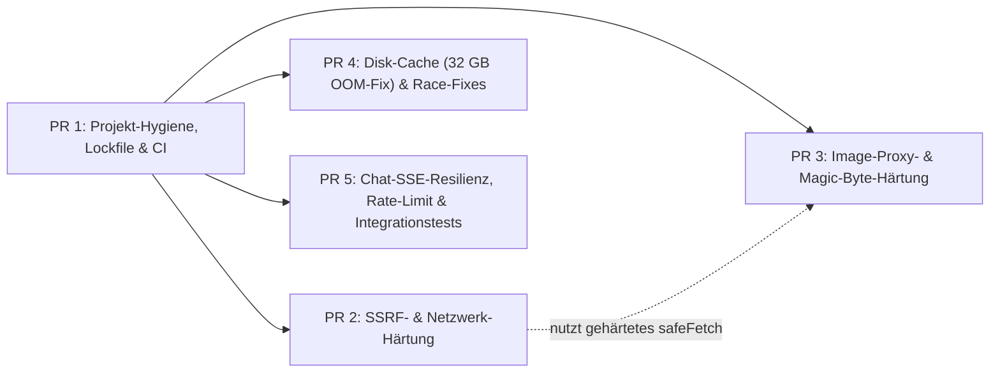

# Reengineering-Plan — MangaReaderApp

> **Basis:** Technisches Audit in [`docs/AUDIT.md`](./AUDIT.md)  
> **Zielsetzung:** Schrittweise Beseitigung aller kritischen und hohen Security-, Stabilitäts- und Hygiene-Risiken in **5 kleinen, voneinander unabhängigen PR-Meilensteinen**, ohne funktionierende Nutzer-Features, API-Verträge oder das AMOLED-Design zu beschädigen.

---

## 1. Übersicht & Meilenstein-Roadmap

Jeder PR-Meilenstein ist so geschnitten, dass er **eigenständig reviewbar, testbar und ohne Breaking Changes mergebar** bleibt:



| PR | Fokus | Behobene Audit-IDs | Hauptnutzen |
| :--- | :--- | :--- | :--- |
| **PR 1** | Hygiene, Lockfile, TS-Strictness & GitHub Actions CI | `HYG-01` | Einheitlicher `npm`-Build, Entfernung toter/unsicherer Altlasten, automatisiertes CI-Sicherheitsnetz |
| **PR 2** | SSRF-Schutz, DNS-Pinning, Redirects & Read-Timeouts | `SEC-01`, `SEC-02`, `SEC-03`, `SEC-05`, `STAB-01`, `STAB-02` (Demo) | Schließt DNS-Rebinding, IPv4-mapped-IPv6-Bypässe, fehlende CIDRs, Tarpit-DoS & Android-Parität |
| **PR 3** | `/api/image-proxy`, Magic-Bytes, Header-Vorabprüfung | `SEC-04`, `STAB-02` (Proxy) | Verhindert 15-MB-Fehl-Buffering, Cache-Poisoning mit Nicht-Bildern & redundante CDN-Retries |
| **PR 4** | Disk-basierter Server-Cache & Concurrency-/Race-Fixes | `CACHE-01`, `CACHE-02` | Verhindert 32-GB-RAM-OOM-Crashes, ermöglicht echte Persistenz und eliminiert Server-/Client-Races |
| **PR 5** | `/api/chat`-SSE-Timeouts, Rate-Limiting & Server-Tests | `CHAT-01`, `CHAT-02` | Verhindert API-Quota-Drain, hängende Streams & schließt die Server-Testlücke vollständig |

> *Hinweis zur Unabhängigkeit:* PR 2 bis PR 5 können auch direkt auf `main` aufsetzen; lediglich PR 3 profitiert fachlich von den `safeFetch`-Primitiven aus PR 2 (falls parallel bearbeitet, nutzt PR 3 vorübergehend das bestehende `safeFetchWithRedirects` über eine saubere Adapter-Schnittstelle).

---

## 2. Was NICHT verändert werden darf (Verbindliche Invarianten)

Alle 5 PRs müssen folgende Verträge, UI-Garantien und Sicherheitsgrenzen **ausnahmslos unverändert bewahren**:

### 2.1 AMOLED-`#000000`-Design & UI-Ergonomie (`src/components/`, `src/index.css`, `index.html`)
- **60-30-10-Farbsystem:**
  - **60 % Neutral-Canvas:** `#000000` (echtes AMOLED-Schwarz im Reader und bei Ladeplatzhaltern), `#0B0A12` (App-Hintergrund).
  - **30 % Strukturelle Oberflächen:** `#141124` / `#131022` / `#120F20` (Karten, Top-Bar, Drawer), `#1D1933` (aktive Felder), Hairline-Rahmen `#221E36` / `#27223D`.
  - **10 % Akzentbudget:** `#BB86FC` / `#7C4DFF` (primäre Aktionen, aktiver Tab-Indikator).
- **Typografie & Disziplin:** `Plus Jakarta Sans` (Überschriften), `DM Sans` (Fließtext), `JetBrains Mono` mit `tabular-nums` (Zähler, HTTP-Codes, Cache-Größen); **Zero-Pill-Disziplin** (`·`-Trenner statt bunter Pill-Badges).
- **Reader-UX & Multi-Tab-Ergonomie:**
  - Flackerfreies Nachladen ohne 200ms-Crossfade; schwarze Platzhalter mit reservierter Mindesthöhe.
  - Nicht-blockierende Tap-Zonen im `paged`-Modus (`22 %` / `56 %` sofortiges HUD ohne 300ms-Verzögerung / `22 %`), `1.0x–4.0x` Zoom und Swipe bei `<= 1.05x`.
  - Breite Browser-Tabs (`152px–220px`) mit isoliertem `24×24px`-Schließen-Button (`✕`) und Touch-Zielen ≥ `44×44px`.

### 2.2 Bestehende HTTP-API-Verträge (`server.ts`)
Kein PR darf bestehende Endpunkt-Pfade, HTTP-Methoden, erwartete JSON-Response-Felder oder Diagnose-Header brechen:
- `POST /api/extract` → Input `{ url }`, Output `{ title, chapterUrl, sourceName, coverUrl, chapterNumber, nextChapterUrl, prevChapterUrl, pages }` (Fehler `400`, `422`, `502` mit `{ error }`).
- `GET /api/image-proxy` → Query `url` (erforderlich), `referer` (optional), `bypassCache=1` (optional); Response-Header `Content-Type`, `Cache-Control: public, max-age=2592000, immutable`, `X-Manga-Cache` (`HIT` / `MISS` / `REFRESHED`), sowie bei Fehlern `X-Manga-Diagnostic` (`HTTP_404`, `HTTP_429`, `HTTP_403`, `HTTP_5XX`, `TIMEOUT`, `HTML_CHALLENGE`, `XML_CHALLENGE`, `NETWORK_ERROR`) und `X-Manga-Received-Content-Type`.
- `POST /api/prefetch` → Input `{ url }`, gleiches Kapitel-JSON-Schema wie `/api/extract`.
- `GET /api/cache/status` → Optional `?maxBytes=`, Output `CacheManagerStats` (`entryCount`, `chapterCount`, `totalBytes`, `maxBytes`, `maxAgeDays: null`, `usagePercent`, `lastPruneAt`, `totalExpiredEvicted`, `totalSizeEvicted`, `totalFreedBytes`).
- `POST /api/cache/cleanup` → Input `{ clearAll?: boolean, maxSizeBytes?: number }`, Output `{ report, stats }`.
- `POST /api/chat` → SSE-Events im Format `data: {"chunk":"..."}\n\n`, `data: {"done":true,"model":"..."}\n\n` und `data: {"error":"..."}\n\n`; strikte Modell-Allowlist (`gemini-4-hydrogen`, `gemini-3.1-flash-lite`) und die 3 Personas (`manga-guide`, `reader-tech`, `story-analyst`).
- `GET /api/demo-page` → Alle `simError`-Fälle (`404`, `403_html`, `429`, `503`, `null_bitmap`, `xml_challenge`) und Assets (`manga1`, `manga2`, `webtoon1`, `cover1`, `cover2`) bleiben exakt abrufbar.

### 2.3 Alle 4 manuell schaltbaren Quality-of-Life-Features & Cache-Policy
1. **QoL 1 — Lesezeichen & optionaler Verlauf:** Ein-/ausschaltbar (`historyTrackingEnabled`), `pendingTargetPage`-Respektierung beim *„Weiterlesen“*, strikte Isolation von Offline-Kapiteln gegenüber Browser-Tabs.
2. **QoL 2 — Helligkeits- & Nachtfilter:** Software-Dimmer (`0 %–80 %`) und Blaulicht-/Sepia-Filter (`10 %–80 %`) als `pointer-events-none`-Overlays im Reader.
3. **QoL 3 — Autoscroll:** Im Webtoon-Modus (`0.5x–3.0x`), Floating-Pill-Steuerung und Screen Wake Lock (`navigator.wakeLock`).
4. **QoL 4 — Automatisches Pre-Fetching:** Auslösung ab den letzten 2 Seiten (`prefetchEnabled`) inkl. Anzeige im `ChapterEndFooter`.
5. **Cache-Policy:** Standardlimit **`4 GB`**, flexibel konfigurierbar von **`512 MB` bis `32 GB`** (Slider, GB-Direkteingabe, Presets `1 GB`–`32 GB`), **keine automatische 31-Tage-Löschung**, 90-%-Hysterese, manuelle Bereinigung und Live-Fortschrittsbalken in `LibraryView` & `SettingsDrawer`.

### 2.4 Bestehende Regressions- & Sicherheitsgrenzen
- Browser-Tab-Rendering strikt mit `key={tab.id}` (kein Tab-State-Vertauschen beim Schließen).
- `isExtracting` in `try / catch / finally` garantiert entsperren.
- MangaDex-UUID-Schutz in `urlChapterAnalyzer.ts` (`isUuidPath: true`, kein blindes Hochzählen).
- Exponential Backoff (`400ms → 800ms → 1600ms`) ausschließlich für `429` / `5xx` / Timeout; sofortiger Diagnose-Abbruch bei `404` / `403` / `HTML_CHALLENGE` / `DECODE_ERROR`.
- `GEMINI_API_KEY` verbleibt strikt serverseitig; kein `dangerouslySetInnerHTML`; keine externen Platzhalter-Bilder im UI.

---

## 3. Die 5 unabhängigen PR-Meilensteine

### PR 1: Projekt-Hygiene, Lockfile-Konsolidierung, TypeScript-Strictness & GitHub Actions CI

- **Ziel:** Eindeutiges `npm`-Ökosystem, aktiviertes `strict: true` in TypeScript, Bereinigung der veralteten Root-`MangaReaderApplication.kt` sowie funktionierende CI-Workflows für Web und Android.
- **Unabhängigkeit:** Keine Änderung an Laufzeit-APIs oder Geschäftslogik; sofort als erster Schritt umsetzbar.
- **Exakte Dateiliste:**
  - `[MODIFY] package.json`
  - `[TRACK] package-lock.json`
  - `[DELETE] bun.lock`
  - `[MODIFY] .gitignore`
  - `[MODIFY] tsconfig.json`
  - `[DELETE] MangaReaderApplication.kt` (im Root)
  - `[NEW] .github/workflows/web-ci.yml`
  - `[NEW] .github/workflows/android-ci.yml`
  - `[DELETE] android-app/ci/build-android-apk.yml`
  - `[NEW] src/utils/storage.test.ts`
  - `[MODIFY] README.md`
  - `[MODIFY] GEMINI.md`
- **Konkrete Umsetzungspunkte:**
  1. `package.json`: `"name"` auf `"mangareader-app"` und `"version"` auf `"2.1.0"` aktualisieren; `"engines": { "node": ">=20" }` setzen; `"test": "tsx --test src/**/*.test.ts"` ergänzen; `"start": "NODE_ENV=production tsx server.ts"` (oder kompilierten Start) mit `cross-env` / Node-Script plattformunabhängig korrigieren; `"tsx"` aus `devDependencies` in `dependencies` verschieben; `"clean"` auf Node-Einzeiler (`node -e "fs.rmSync(...)"`) umstellen; ungenutzte Pakete (`motion`, `autoprefixer`, `esbuild`) entfernen.
  2. `bun.lock` entfernen und `package-lock.json` sauber in Git einchecken.
  3. `tsconfig.json`: `"strict": true` aktivieren, `"types": ["vite/client", "node"]` ergänzen, `"android-app"` zu `"exclude"` hinzufügen und auftretende Typfehler beheben.
  4. Root-`MangaReaderApplication.kt` löschen und Verweise in `README.md` sowie `GEMINI.md` auf `android-app/app/src/main/java/com/mangareader/app/MangaReaderApplication.kt` (inkl. Korrektur der `GEMINI.md`-Doku-Drift zu `cookieHeader`/`simError`) aktualisieren.
  5. `.github/workflows/web-ci.yml` anlegen (`npm ci`, `npm run lint`, `npm test`, `npm run build`) und `android-app/ci/build-android-apk.yml` nach `.github/workflows/android-ci.yml` verschieben.
  6. `src/utils/storage.test.ts` für `SerializedStorage` (Debounce, `saveImmediate`, Queue-Reihenfolge, Quota-Fehlerbehandlung) ergänzen.
- **Akzeptanzkriterien & Verifikation:**
  - `npm ci && npm run lint && npm test && npm run build` läuft unter Node `>=20` fehlerfrei durch.
  - `git ls-files` enthält `package-lock.json` und keine `bun.lock` / Root-`MangaReaderApplication.kt` mehr.

---

### PR 2: SSRF- & Netzwerk-Härtung (IPv4/IPv6-Edge-Cases, DNS-Pinning, Redirects & Read-Timeouts)

- **Ziel:** Vollständige Schließung aller verifizierten SSRF-Bypässe (DNS-Rebinding, IPv4-mapped-IPv6-Hex, fehlende CIDRs, Trailing-Dot-Domains), Behebung des hängenden `READ_TIMEOUT_MS` sowie Behebung des `/api/demo-page`-Prototype-Crashes.
- **Unabhängigkeit:** Kapselt Validierung und HTTP-Fetch in einem eigenständigen `safeFetch`-Modul ohne Änderung an Cache-, Proxy-Caching- oder Chat-Logik.
- **Exakte Dateiliste:**
  - `[MODIFY] src/utils/urlSafety.ts`
  - `[MODIFY] src/utils/urlSafety.test.ts`
  - `[NEW] src/server/safeFetch.ts`
  - `[NEW] src/server/safeFetch.test.ts`
  - `[MODIFY] server.ts`
  - `[MODIFY] android-app/app/src/main/java/com/mangareader/app/util/UrlSafety.kt`
  - `[MODIFY] android-app/app/src/test/java/com/mangareader/app/UrlSafetyTest.kt`
- **Konkrete Umsetzungspunkte:**
  1. **`urlSafety.ts` & Android-Parität `UrlSafety.kt`:**
     - IPv4-Prüfung auf echte 32-Bit-Integer-CIDR-Masken umstellen (`0.0.0.0/8`, `10.0.0.0/8`, `100.64.0.0/10`, `127.0.0.0/8`, `169.254.0.0/16`, `172.16.0.0/12`, `192.0.0.0/24`, `192.0.2.0/24`, `192.168.0.0/16`, `198.18.0.0/15`, `198.51.100.0/24`, `203.0.113.0/24`, `224.0.0.0/4`, `240.0.0.0/4`).
     - Vollständige IPv6-Normalisierung in acht 16-Bit-Gruppen (`0..0xffff`) inklusive Dekodierung von **Hex-IPv4-mapped-IPv6** (`::ffff:7f00:1`, `::ffff:a9fe:a9fe`), IPv4-translated (`::ffff:0:0:0/96`), NAT64 (`64:ff9b::/96`, `64:ff9b:1::/48`), 6to4 (`2002::/16`), Multicast (`ff00::/8`), `fec0::/10`, Documentation (`2001:db8::/32`) und Zone-ID-Stripping (`%...`).
     - Trailing-Dot-Normalisierung (`host.replace(/\.+$/, '')`) vor Hostname-Checks (`localhost.`, `metadata.google.internal.`) sowie Standard-Port-Allowlist (`''`, `'80'`, `'443'`).
  2. **`src/server/safeFetch.ts`:**
     - Brackets von IPv6-Literalen vor `dns.lookup()` entfernen (`hostname.replace(/^\[|\]$/g, '')`).
     - **DNS-Pinning gegen DNS-Rebinding:** Custom Undici `Agent` / `lookup`-Callback (oder Node `http`/`https`-Agent), der die geprüfte öffentliche IP direkt an die TCP-Verbindung bindet, sodass zwischen Prüfung und Connect keine zweite DNS-Abfrage stattfindet.
     - Bei 3xx-Redirects `await res.body?.cancel()` aufrufen, Ziel-URL erneut durch `validateExternalUrl()` + DNS-Pinning prüfen und pro Hop `Referer`/`Sec-Fetch-Site` sauber neu berechnen.
     - Echtes Read-Timeout über `AbortController` + `setTimeout(..., READ_TIMEOUT_MS)` während des gesamten `readResponseWithLimit()`-Streamings (schützt gegen hängende `reader.read()`-Aufrufe).
     - Typisierte `SsrfBlockedError` (HTTP `400`/`403`) und `UpstreamTimeoutError` (HTTP `504`), damit `server.ts` SSRF-Blockaden nicht als `502` ausliefert.
  3. **`server.ts` Basis-Härtung:**
     - `Object.hasOwn(DEMO_ASSETS, assetKey)` in `/api/demo-page` (`Z. 240`).
     - `HOST` über `process.env.HOST || '0.0.0.0'` konfigurierbar machen, globale Security-Header (`X-Content-Type-Options: nosniff`, `Referrer-Policy: no-referrer`) und globale Express-JSON-Error-Middleware ergänzen.
- **Akzeptanzkriterien & Verifikation:**
  - Alle neuen Edge-Cases (`[::ffff:a9fe:a9fe]`, `[64:ff9b::7f00:1]`, `http://localhost./`, `http://198.18.0.1/`, `http://239.255.255.250/`, `http://example.com:22/`, DNS-Rebinding-Mock, Slow-Body-Read-Timeout-Mock) bestehen in `urlSafety.test.ts`, `safeFetch.test.ts` und Android `UrlSafetyTest.kt`.

---

### PR 3: `/api/image-proxy`-Härtung (Referer-Fallback, Magic-Bytes, Vorab-Header-Prüfung & Request-Deduplizierung)

- **Ziel:** Verhindern von 15-MB-Fehl-Buffering und Cache-Poisoning auf `/api/image-proxy`, Optimierung der Referer-Kette, Beseitigung von Stream-Leaks und Deduplizierung von `/api/extract` + `/api/prefetch`.
- **Unabhängigkeit:** Betrifft ausschließlich die Proxy-Pipeline und Bildvalidierung; berührt weder Cache-Storage-Backend noch Chat-Endpunkt oder UI.
- **Exakte Dateiliste:**
  - `[MODIFY] src/utils/imageDiagnostics.ts`
  - `[MODIFY] src/utils/imageDiagnostics.test.ts`
  - `[NEW] src/server/imageProxy.ts`
  - `[NEW] src/server/imageProxy.test.ts`
  - `[MODIFY] server.ts`
- **Konkrete Umsetzungspunkte:**
  1. **`imageDiagnostics.ts`:**
     - `hasValidImageMagicBytes(bufferPrefix, contentType)` ergänzen: prüft auf nicht-leeren Buffer sowie Signaturen für JPEG (`FF D8 FF`), PNG (`89 50 4E 47`), GIF (`GIF87a`/`GIF89a`), WebP (`RIFF....WEBP`), BMP (`BM`), AVIF/HEIF (`ftyp`), ICO.
     - `SAFE_IMAGE_CONTENT_TYPES`-Allowlist (`image/jpeg`, `image/png`, `image/webp`, `image/gif`, `image/bmp`, `image/avif`, `image/x-icon`) definieren (schließt `image/svg+xml` weiterhin strikt aus).
     - Challenge-Inspection-Puffer auf die ersten `1024` Bytes (statt `256`) erweitern, damit auch HTML-Dokumente mit vorgelagertem Whitespace/BOM erkannt werden.
  2. **`src/server/imageProxy.ts`:**
     - **Vorab-Header-Check vor Body-Buffering:** `upstream.headers.get('content-type')` und `content-length` prüfen, bevor Bytes eingelesen werden; bei eindeutigem Nicht-Bild sofort `await upstream.body?.cancel()`.
     - **Referer-Kette optimieren & deduplizieren:** `[refererUrl?.toString(), refererUrl ? `${refererUrl.origin}/` : null, `${imgCheck.url.origin}/`, null]` dedupliziert (keine doppelten Same-Origin-Requests).
     - **Gezieltes Retry-Verhalten:** Nur bei `401`, `403` und erkannten HTML-/XML-Challenges auf die nächste Referer-Stufe wechseln; bei `404`, `429`, `5xx` oder `SsrfBlockedError` sofort sauber abbrechen und `upstream.body?.cancel()` aufrufen.
     - **In-Flight-Request-Deduplizierung:** Gleichzeitige Proxy-Anfragen an identischen `cacheKey` teilen sich einen laufenden Fetch (Thundering-Herd-Schutz).
     - `X-Content-Type-Options: nosniff` auf ausgelieferten Bild-Antworten setzen; `getSecFetchSite()` um eine kleine Multi-Label-Suffix-Liste (`.co.uk`, `.com.br`, `.com.au`, `.ne.jp`, `.or.jp`, `.pages.dev`) präzisieren.
  3. **Extraktions-Deduplizierung in `server.ts`:** Gemeinsame Hilfsfunktion für `/api/extract` und `/api/prefetch` extrahieren (bei 100 % identischen JSON-Responses).
- **Akzeptanzkriterien & Verifikation:**
  - `imageDiagnostics.test.ts` und `imageProxy.test.ts` (mit lokalem Mock-HTTP-Upstream-Server) verifizieren: 0-Byte-Ablehnung, Fake-`image/jpeg`-JSON-Ablehnung, Vorab-Abbruch bei `text/html` ohne Body-Buffering, deduplizierte Referer-Tiers, korrekte `X-Manga-Diagnostic`-Header und In-Flight-Deduplizierung.

---

### PR 4: Disk-basierter Server-Cache (OOM-Schutz bis 32 GB) & Concurrency-/Race-Condition-Fixes

- **Ziel:** Beseitigung des kritischen OOM-Risikos durch einen echten, neustart-persistenten Disk-Cache auf dem Server (bis `32 GB`), Eliminierung aller Server-/Client-Race-Conditions und Beseitigung der Byte-Doppelzählung im UI — bei unverändertem API-Vertrag.
- **Unabhängigkeit:** Eigenständige Storage-Schicht unterhalb von `ChapterCacheManager` / `ClientCacheManager`; UI-Änderungen betreffen nur Debounce/Race-Schutz und Cache-Statistik-Anzeige.
- **Exakte Dateiliste:**
  - `[NEW] src/server/diskCacheStore.ts`
  - `[NEW] src/server/diskCacheStore.test.ts`
  - `[MODIFY] src/utils/cacheManager.ts`
  - `[MODIFY] src/utils/cacheManager.test.ts`
  - `[MODIFY] server.ts`
  - `[MODIFY] src/App.tsx`
  - `[MODIFY] src/components/SettingsDrawer.tsx`
  - `[MODIFY] src/components/LibraryView.tsx`
- **Konkrete Umsetzungspunkte:**
  1. **`src/server/diskCacheStore.ts`:**
     - Speichert Bild-Payloads unter einem festen Root-Verzeichnis (`MANGA_CACHE_DIR` oder `<cwd>/.cache/images`) mittels **SHA-256-Hex-Dateinamen** (`<sha256>.bin` + `<sha256>.meta.json`) — konstruktionsbedingt immun gegen Path Traversal.
     - Atomares Schreiben über Tempfile + `fs.promises.rename()`, geschützt durch Key-/Prune-Mutex und Generation-Counter (`clearAll` inkrementiert `generation`; laufende Proxy-Fetches mit älterer `generation` verwerfen den Cache-Write).
     - Hält im Node-RAM ausschließlich den schlanken Metadaten-Index (keine Bild-Buffer!), erzwingt das konfigurierbare Disk-Limit (`512 MB – 32 GB`, Standard `4 GB`, **keine 31-Tage-Auto-Löschung**, 90-%-LRU-Hysterese) und lädt beim Server-Start den bestehenden Disk-Index wieder ein.
  2. **`ClientCacheManager` (`src/utils/cacheManager.ts`):**
     - Interne `withLock()`-Promise-Queue für `recordCachedImage()`, `getCachedImageBlob()`, `clearOldCache()`, `clearAll()` und `invalidateUrl()`, damit parallele Webtoon-Seiten den `localStorage`-Index nicht mehr überschreiben.
  3. **Client-/Server-Synchronisation (`App.tsx`, `SettingsDrawer.tsx`, `LibraryView.tsx`):**
     - Debouncing (`300 ms`) und `AbortController` in `validateCacheLimitNow()` (`App.tsx`) für Slider-/GB-Eingaben (sofortige lokale Validierung + entprellter Server-Sync ohne Out-of-Order-Überholen).
     - Eindeutige Ausweisung von Client- vs. Server-Cache-Nutzung (`Math.max` bzw. getrennte Kennzahl statt Addition derselben gecachten Bilder gegen das Limit), bei Erhalt der bestehenden UI-Fortschrittsleiste und `testId`-Attribute.
- **Akzeptanzkriterien & Verifikation:**
  - `diskCacheStore.test.ts` und `cacheManager.test.ts` verifizieren: Neustart-Persistenz, SHA-256-Isolation (kein Path Traversal), 90-%-LRU-Eviction ohne 31-Tage-Ablauf, Generation-Guard gegen `clearAll`-TOCTOU und konkurrierende `ClientCacheManager`-Writes.
  - Speicherverbrauch des Node-Prozesses bleibt bei großem Cache konstant niedrig (keine Bild-Buffer im Heap).

---

### PR 5: `/api/chat`-SSE-Resilienz, Rate-Limiting, Graceful Shutdown & Server-Integrationstests

- **Ziel:** Produktionsreife SSE-Streaming-Stabilität, Schutz vor API-Quota-Drain, sauberes Herunterfahren des Servers und durchgängige HTTP-/SSE-Integrationstests für `server.ts`.
- **Unabhängigkeit:** Kapselt `/api/chat` und Rate-Limiting in dedizierten Server-Modulen und fügt das bisher fehlende Integrationstest-Netz hinzu.
- **Exakte Dateiliste:**
  - `[NEW] src/server/chatHandler.ts`
  - `[NEW] src/server/rateLimit.ts`
  - `[MODIFY] src/utils/chatHelpers.ts`
  - `[MODIFY] src/utils/chatHelpers.test.ts`
  - `[MODIFY] src/components/ChatView.tsx`
  - `[MODIFY] server.ts`
  - `[NEW] src/server/server.integration.test.ts`
- **Konkrete Umsetzungspunkte:**
  1. **`src/server/chatHandler.ts` & `server.ts`:**
     - `AbortController` auf `/api/chat`, verknüpft mit `req.on('close')` / `res.on('close')`, **First-Token-Timeout** (`20s`) und **Idle-Chunk-Timeout** (`30s`).
     - SSE-Header `X-Accel-Buffering: no`, periodischer Heartbeat (`: ping\n\n` alle `15s`) und `res.destroyed`-Prüfung in `writeEvent`.
     - Fehlerbereinigung: keine rohen `err.message`-Leaks mehr im Catch-Block (serverseitiges Logging + standardisierte, sichere deutsche Fehlermeldung im SSE-`error`-Event).
  2. **`src/server/rateLimit.ts`:**
     - Leichtgewichtiges, konfigurationsfreies In-Memory-Sliding-Window-Rate-Limiting pro IP für `/api/chat`, `/api/extract`, `/api/prefetch`, `/api/image-proxy` und `/api/cache/cleanup` (HTTP `429` mit `Retry-After` und JSON `{ error }`).
  3. **`src/utils/chatHelpers.ts` & `src/components/ChatView.tsx`:**
     - `sanitizeContextValue()` entfernt `\r`, `\n` und Steuerzeichen aus `ChatContextSummary`-Feldern vor der Einfügung in `systemInstruction`.
     - `sanitizeChatHistory()` normalisiert Turns auf gültige Alternierung (`user` → `model`) und entfernt führende `model`-Turns.
     - `ChatView.tsx`: Nach `done === true` expliziter `decoder.decode()`-Final-Flush plus Verarbeitung einer verbleibenden Zeile in `buffer`.
  4. **Testbare Server-Fabrik & Integrationstests:**
     - `createApp()` und `startServer()` sauber trennen (`server.ts` startet `listen()` nur bei direkter Ausführung) und Graceful Shutdown (`SIGINT`/`SIGTERM`: Stoppt HTTP-Server + `clearInterval` auf Cache-Maintenance) ergänzen.
     - `src/server/server.integration.test.ts`: Testet alle 7 Endpunkte (`/api/cache/status`, `/api/cache/cleanup`, `/api/demo-page`, `/api/image-proxy`, `/api/extract`, `/api/prefetch`, `/api/chat`) gegen lokale HTTP-/SSE-Mock-Server.
- **Akzeptanzkriterien & Verifikation:**
  - `npm test` führt Unit- und Integrationstests gemeinsam aus.
  - Abbruch eines Chat-Requests im Browser beendet nachweislich den serverseitigen Stream; hängender Upstream triggert sauberes SSE-Timeout-Event; Rate-Limit greift deterministisch mit HTTP `429`.

---

## 4. Standard-Verifikations-Checkliste für jeden PR

Vor dem Merge jedes einzelnen PRs sind zwingend auszuführen:

```bash
# 1. Statische Typprüfung (ab PR 1 mit strict: true)
npm run lint

# 2. Alle Unit- und Server-Tests (ab PR 1 über npm test)
npm test

# 3. Produktions-Bundle bauen
npm run build

# 4. Bei Android-Änderungen (PR 1 CI-Umzug & PR 2 UrlSafety-Parität)
cd android-app && ./gradlew testDebugUnitTest assembleDebug
```

Zusätzlich für jeden PR manuell prüfen:
- [ ] Reader rendert weiterhin auf `#000000` (AMOLED), Zoom/Tap-Zonen bleiben ungestört.
- [ ] Alle 4 QoL-Schalter im `SettingsDrawer` sowie Cache-Limit (`4 GB` Standard, `512 MB – 32 GB`, kein 31-Tage-Verfall) funktionieren unverändert.
- [ ] Keine API-Routen-Pfade, Request-/Response-Schemas oder `X-Manga-*`-Diagnose-Header wurden gebrochen.
